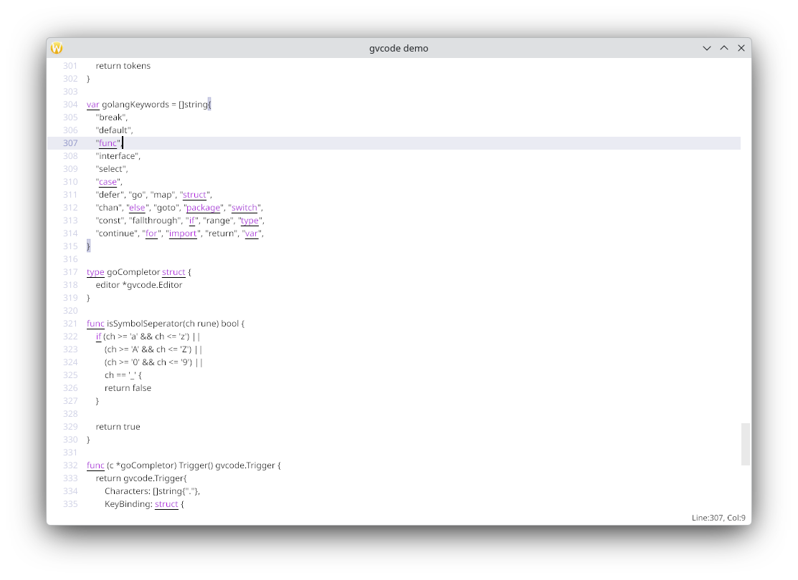

# gvcode 


[](https://pkg.go.dev/github.com/oligo/gvcode)


gvcode is a Gio based text editor component for code editing, originally created for [Typstify](https://github.com/typstify/typstify).

## Key Features:

- Uses a PieceTable backed text buffer for efficient text editing.
- Optimized undo/redo operations with built-in support in the PieceTable, including grouping of related edits (e.g. an IME composition is undone as a single batch).
- Supports both hard and soft tabs, ensuring alignment with tab stops.
- Lines can be wrapped or left unwrapped, with horizontal scrolling supported.
- Syntax highlighting by applying TextMate-style scopes and color schemes, with parent scope fallback.
- Built-in line numbers for better readability.
- Extensible gutter system: multiple custom providers, interactive providers (click/hover), and full-width line highlighting.
- Text markers to track positions and ranges across edits.
- Text decorations to highlight text using background, underline, squiggle, strikethrough, border, bold and italic styles. Decorations automatically follow text edits.
- Auto-completion of bracket pairs and quote pairs, including smart skip-over and paired deletion.
- Auto-indent of new lines.
- Bracket-aware auto-indent.
- Increase or decrease indents of selected lines using Tab and Shift+Tab.
- Highlighting of matching brackets and all occurrences of the word/selection at the caret.
- Expanded shortcuts support via command registry, with commands that can be registered and removed at runtime.
- Hooks to intercept paste, Enter/Return and normal text input.
- Flexible auto-completion via the Completion API, a built-in implementation is provided as an add-on.
- Add-ons for completion popups and VCS diffs (diff gutter provider and diff popup).
- Editor modes: normal, read-only and LSP snippet mode.
- LSP snippet support with tab-stop/placeholder navigation.
- LF/CRLF line-ending detection and conversion.
- Indentation detection for tabs vs. spaces and indent width.
- Large file rendering supported by incremental, paragraph-based rendering.
- Cross-platform IME support: Windows, macOS, and Linux are supported.
- Rich configuration options.

## Why another code editor?

I ported Gio's editor component to [gioview](https://github.com/oligo/gioview) and added a few features to support basic code editing, but it is far from a good code editor. Keep expanding the original editor seems a wise decision, but the design of the original editor makes it hard to adding more features. And it is also not performant enough for large file editing/rendering. Most importantly it lacks tab/tab stop support. When I tried to add tab stop support to it, I found it needs a new overall design, so there is gvcode.


## Screenshots


## How To Use

Gvcode exports simple APIs to ease the integration with your project. Here is a basic example:

```go
package main

import (
	"os"

	"gioui.org/app"
	"gioui.org/font"
	"gioui.org/op"
	"gioui.org/unit"
	"gioui.org/widget/material"
	"github.com/oligo/gvcode"
	"github.com/oligo/gvcode/widget"
)

func main() {
	th := material.NewTheme()

	// widget.NewEditor builds an editor preconfigured with the theme.
	editor := widget.NewEditor(th)
	editor.WithOptions(
		gvcode.WithFont(font.Font{Typeface: "monospace"}),
		gvcode.WithTextSize(unit.Sp(12)),
		gvcode.WithLineHeight(0, 1.5),
	)
	editor.SetText("Hello, gvcode!")

	go func() {
		w := new(app.Window)
		w.Option(app.Title("gvcode example"))

		var ops op.Ops
		for {
			e := w.Event()

			switch e := e.(type) {
			case app.DestroyEvent:
				os.Exit(0)
			case app.FrameEvent:
				gtx := app.NewContext(&ops, e)
				editor.Layout(gtx, th.Shaper)
				e.Frame(gtx.Ops)
			}
		}
	}()

	app.Main()
}
```

For a full working example, please see code in the folder `./example`, or code in [Typstify](https://github.com/typstify/typstify).

For complete API documentations, please read it on [Godoc](https://pkg.go.dev/github.com/oligo/gvcode)


## Cautions

`gvcode` is not intended to be a drop-in replacement for the official Editor widget as it dropped some features such as single line mode, truncator and max lines limit. 

This project is a work in progress, and the APIs may change as development continues. Please use it at your own risk.


## Contributing

See the [contribution guide](CONTRIBUTING.md) for details.


## Acknowledgments

This project uses code from the [Gio](https://gioui.org/) project, which is licensed under the Unlicense OR MIT License.

